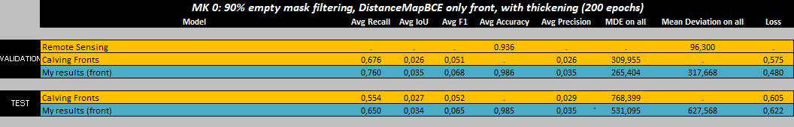
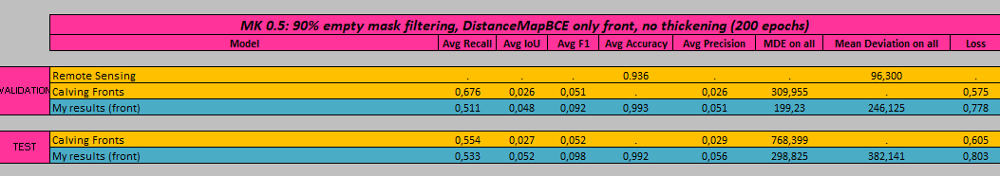
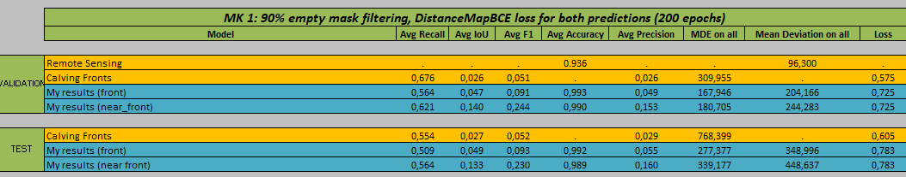
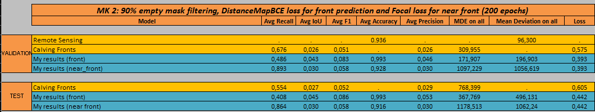
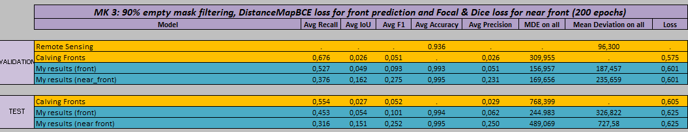
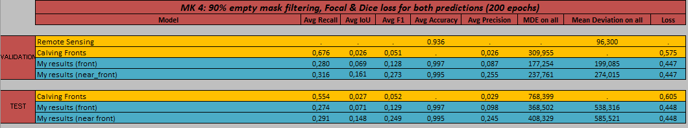

# FrostyCalvNet

## 📌 Overview

This repository is part of the research work conducted for a Master's thesis in Engineering in Computer Science at the University of Rome "La Sapienza". 

The study focuses on the application of Deep Learning techniques for the automatic detection of glacier calving fronts from satellite imagery.

The objective of this thesis is to design, implement, and evaluate deep neural network architectures capable of accurately segmenting glacier front boundaries, in order to analyze the melting and retreat processes affecting various glaciers worldwide. The analysis spans a temporal range from 1995 to 2020, using SAR satellite images and geospatial data provided primarily by the CAFFEE dataset.

By leveraging solid segmentation models (such as Calving_Fronts_and_Where_to_Find_Them, AMD-HookNet, Bayesian U-Net, and other convolutional and transformer-based networks) this project aims to provide both precise front delineation and an estimation of glacier evolution patterns over time. The ultimate goal is to produce a system that not only offers retrospective insights on glacier behavior, but that may also serve as a foundation for future applications in climate change monitoring, glaciology, and environmental risk assessment.


---

## 📂 Project Structure

```bash
FrostyCalvNet/
│
├── data_processing/       # Pre and Postprocessing operations
├── env/                   # Script to create and setup conda env
├── gifs/                  # Animated images
├── models/                # Neural networks to be used
├── utils/                 # References and Documentation
├── train.py               # Entry point for training
├── validate_or_test.py    # Entry point for validation\test
├── requirements.txt       # Additional env requirements
└── README.md
```

---

## 🧭 Step 1 — Literature Review & Research

Most coherent and relevant Neural Networks: 

- Calving_Fronts_and_Where_to_Find_Them,
- Remote Sensing,
- AMD-HookNet,
- Bayesian U-Net,
- CALFIN.

Related Papers:

- Calving fronts and where to find them: a benchmark dataset and methodology for automatic glacier calving front extraction from synthetic aperture radar imagery
- Remote Sensing - Detection of Glacier Calving Margins with Convolutional Neural Networks: A Case Study
- AMD-HookNet for Glacier Front Segmentation (Wu et al., 2023)
- Bayesian U-Net for Glacier Segmentation in SAR Imagery
- Calving Front Machine (CALFIN): glacial termini dataset and automated deep learning extraction method for Greenland, 1972-2019

Selected Dataset: 

- CAFFEE Dataset

## 🚀 Step 2 — Developing new ideas from Calving_Fronts_and_Where_to_Find_Them on CAFFEE

Deep study of related paper and code, especially for:

- Getting acquainted with data and neural network structure.
- Understanding its complexity
- Examining its results
- Looking for improvements and original ideas to integrate

### Step 2.0 - Conda Environment Creation and Setup

Run the script `'/env/setup_conda_env.sh'` to create and prepare the conda environment.

### Step 2.1 - Data Preparation

Download data here: https://doi.org/10.1594/PANGAEA.940950

And copy the content of the downloaded `/data_raw/CAFFE` into a folder named `/data_raw` in the parent directory of `/FrostyCalvNet` (beside of it).
Run then the `data_processing/check_raw_data_is_correct.py`, so that you can check that nothing broke during the download.

Next, generate the near-front masks by running `data_processing/generate_near_front.py`.
This script reads the front labels in `data_raw/fronts` and stores the derived masks in `data_raw/near_fronts`.

Finally, run the `data_processing/data_preprocessing.py` script to preprocess the data.
This will split the training data into validation and training sets, as used in the paper, and divide the images and labels into patches, storing them in the new directory `data`, which will be beside `/data_raw` and `/FrostyCalvNet`. 
If you prefer to use a new random val-train-split, please delete `data_processing/data_splits/train_idx.txt` and `data_processing/data_splits/val_idx.txt`.

After preprocessing, you can optionally remove patches that contain no labeled pixels by running:

    python data_processing/filter_empty_patches.py

This utility scans the processed `data` directory and deletes patch triplets with empty ground-truth masks
across the `train`, `val`, and `test` splits while keeping a small fraction of negative examples (controlled
via the `--keep_ratio` argument).

A `/FrostyCalvNet/data_splts` folder will be created with two .txt file: `train_idx.txt` and `val_idx.txt`.

### Step 2.2 - Model Training

---

Run:

    python3 train.py --target_masks "zones"

or:

    python3 train.py --target_masks "fronts"

depending on which model you want to train.
There are also some more command line arguments you can use.
Run the following to see what you can alter:

    python3 train.py -h

### Step 2.3 - Validation and Testing

---

Use the `validate_or_test.py` script for both validation and testing. 
The command line argument `--mode` determines whether the test or validation set is used.
Other necessary command line arguments are:

- *--target_masks*: Either 'fronts' or 'zones'.
- *--run_number*: The model's run number of the checkpoint file you want to load. 
  You can check the run number in the folder structure of the checkpoint (checkpoints/..._segmentation/run__?).
- *--version_number*: The version number of the hparams file you want to load 
  (the hparams file is needed to load the model). 
  You can check the version number in the folder structure of the hparams file 
  (tb_logs/..._segmentation/run__.../log/version_?).
- *--checkpoint_file*:  The name of the checkpoint file you want to load. 
  For front segmentation, choose the checkpoint file that has the lowest validation loss 
  (you can see the validation loss in the name). 
  For zone segmentation, choose the checkpoint file that has the highest validation metric (IoU) 
  (you can see the validation metric in the name).

## ❗Step 3 — Variants, Changes and Enhancements

To better understand the improvements derived from my experiments, I developed different code variants.
Each version was evaluated both against one another and in comparison with existing scientific papers addressing similar tasks.

🔧 Common Experimental Settings

All variants share the following setup and improvements compared to the original Calving Fronts paper:

- Training epochs: 200

- Dataset preprocessing: removal of ~90% empty image-mask pairs (no labels)

- Front pixel ratio script: measures predicted vs. ground-truth pixels on validation/test sets

- Validation strategy: not applied during training, but evaluated separately in dedicated sessions

- MDE computation: optimized with KD-Tree for efficiency

- Additional metrics: accuracy included alongside recall, IoU, F1, precision, MDE, and loss

- Logging & visualization: all runs save logs and plots to track training and evaluation trends

- EarlyStopping: not employed

###  Step 3.1 - MK0 variant

All the common and previously described features are implemented, it is basically the prototype and very first version of a new approach to the Calving Front paper baseline.

You can find below the related results:



###  Step 3.2 - MK0.5 variant

Minor extension of the previous variant, with the only difference on a preprocess and postprocess step:

in fact, here the thickening of front line labels process is removed and, accordingly, also the postprocess related part. 

You can find below the related results:



###  Step 3.3 - MK1 variant

Extension of previous variant with introduction of double prediction: on front and on near front lines (and related mask generation script).

You can find below the related results:



###  Step 3.4 - MK2 variant

Extension of previous variant with the replacement of DistanceMapBCE loss function for near front segmentation with Focal loss function (parameters: alpha = 0 and gamma = 1.0)

You can find below the related results:



###  Step 3.5 - MK3 variant

Extension of previous variant with the replacement of Focal loss function for near front segmentation with combination of Dice and Focal loss functions (parameters: alpha = 0, gamma = 1.0, near_loss_focal_weight = 0.5 and near_loss_dice_weight = 0.5)

You can find below the related results:



###  Step 3.6 - MK4 variant

Extension of previous variant with the replacement of DistanceMapBCE loss function for front segmentation with combination of Dice and Focal loss functions (parameters: alpha = 0, gamma = 1.0, front_loss_focal_weight = 0.5 and front_loss_dice_weight = 0.5)

You can find below the related results:




